# Sanity blog editor: SEO & schema features (developer guide)

The blog editor in Sanity Studio (`/studio`) now works like WordPress + Yoast. Each screenshot has numbered red boxes. The table under it maps every number to the file that controls it.

**Data flow:** an editor fills in fields in the Studio. `getPost()` in `src/sanity/client.ts` fetches them. The blog page `src/app/(site)/blog/[slug]/page.tsx` then renders the metadata and JSON-LD.

**Safe to change:** labels, help text and the score rules.
**Breaks existing posts if renamed:** field `name`s. Use a migration instead.

---

## 1. Sidebar, post list and tabs

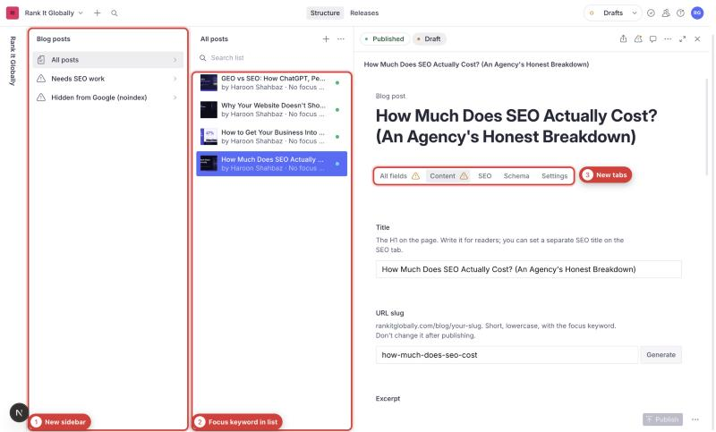

| # | Feature | File |
|---|---|---|
| 1 | Custom sidebar: Blog posts › All posts / Needs SEO work / Hidden from Google, plus Categories, Authors and Leads | `src/sanity/structure.ts`, wired up in `sanity.config.ts` |
| 2 | Post list subtitle: author · 🔑 focus keyword (or "No focus keyword") · noindex | `preview` in `src/sanity/schemaTypes/post.ts` |
| 3 | Tabs: Content / SEO / Schema / Settings | `groups` and each field's `group` in `post.ts` |

## 2. Content tab fields

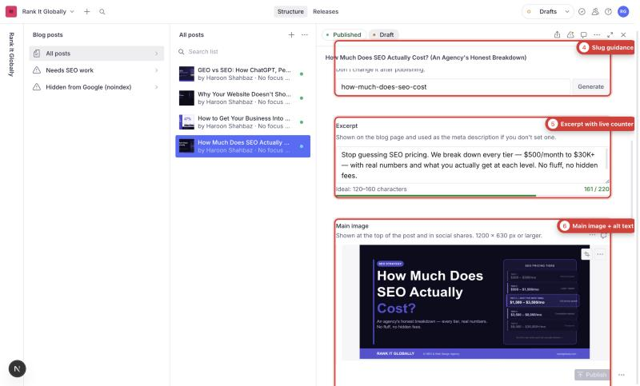

| # | Feature | File |
|---|---|---|
| 4 | URL slug with guidance text | `slug` field in `post.ts` |
| 5 | Excerpt with a live character counter (green, amber or red) | `excerpt` in `post.ts`; counter in `src/sanity/components/CharCountInput.tsx` |
| 6 | Main image with a required alt-text sub-field | `mainImage.fields.alt` in `post.ts` |

## 3. Article editor toolbar

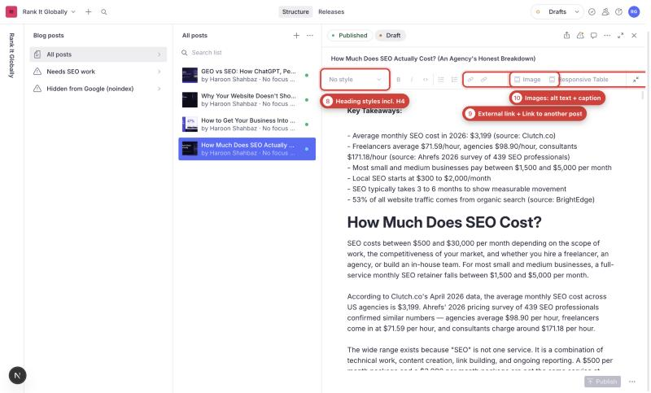

| # | Feature | File | Rendered on site by |
|---|---|---|---|
| 8 | Heading styles: Normal, H2, H3, **H4**, Quote | `styles` in `src/sanity/schemaTypes/blockContent.ts` | `block.h4` in `blog/[slug]/page.tsx` |
| 9 | **External link** (open in new tab, nofollow) and **Link to another post** (picks a post) | `annotations` in `blockContent.ts` | `marks.link` and `marks.internalLink` in `page.tsx`. The internal link slug is resolved in the GROQ query in `client.ts` |
| 10 | Images with alt text and caption | image `fields` in `blockContent.ts` | `types.image` (`<figure>` + `<figcaption>`) in `page.tsx`; styles in `src/app/globals.css` (`.blog-body-figure`) |

## 4. SEO tab: Google preview and SEO analysis

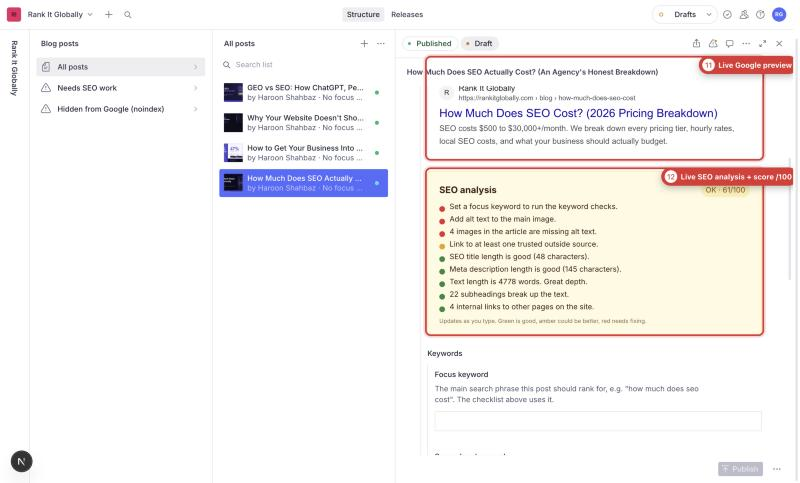

| # | Feature | File |
|---|---|---|
| 11 | Live Google preview of title, URL and description | `GooglePreview` in `src/sanity/components/SeoPanel.tsx` |
| 12 | Live SEO analysis with a score out of 100 and green/amber/red checks | Panel: `SeoPanel.tsx`. **All rules and thresholds:** `src/sanity/lib/seoAnalysis.ts` (`analyse()`, `score()`, `titleRange`, `descriptionRange`) |

The score is 2 points per green check and 1 per amber, as a percentage. To add or change a check, edit `analyse()`.

## 5. SEO tab: keywords, title and description

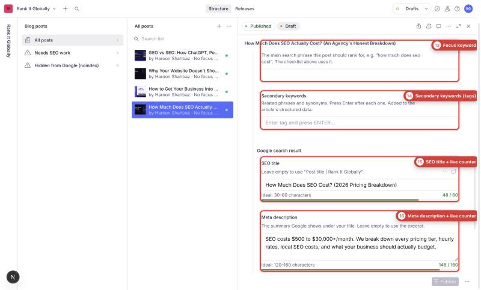

| # | Feature | File | Output on the live page |
|---|---|---|---|
| 13 | Focus keyword | `focusKeyword` in `src/sanity/schemaTypes/seo.ts` | Used by the analysis. Also in `<meta name="keywords">`, `article:tag` and the JSON-LD `keywords` |
| 14 | Secondary keywords (tags) | `secondaryKeywords` in `seo.ts` | Same as #13, with duplicates removed (`postKeywords()` in `page.tsx`) |
| 15 | SEO title with live counter (30–60) | `seo.title` | `<title>`. Falls back to "Post title \| Rank It Globally" |
| 16 | Meta description with live counter (120–160) | `seo.description` | `<meta name="description">`. Falls back to the excerpt |

## 6. SEO tab: social sharing

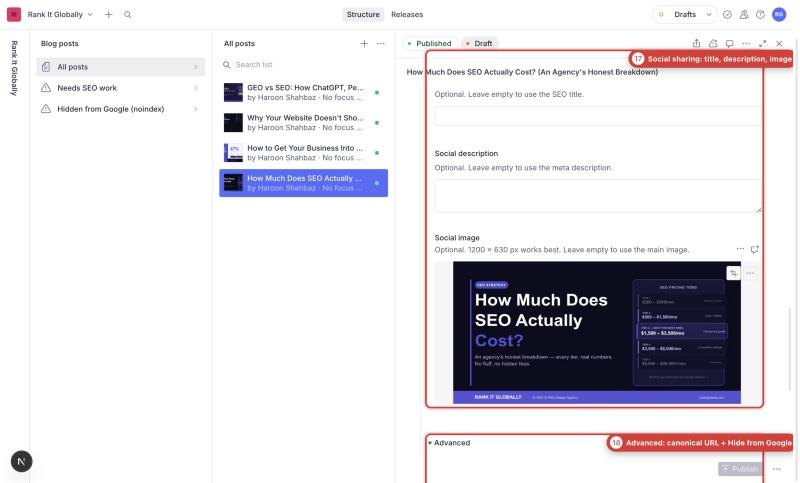

| # | Feature | File | Output |
|---|---|---|---|
| 17 | Social title, description and image | `ogTitle`, `ogDescription`, `image` in `seo.ts` | Open Graph and Twitter tags in `generateMetadata()` in `page.tsx`. The image is cropped to 1200×630 and falls back to the main image |

## 7. SEO tab: advanced

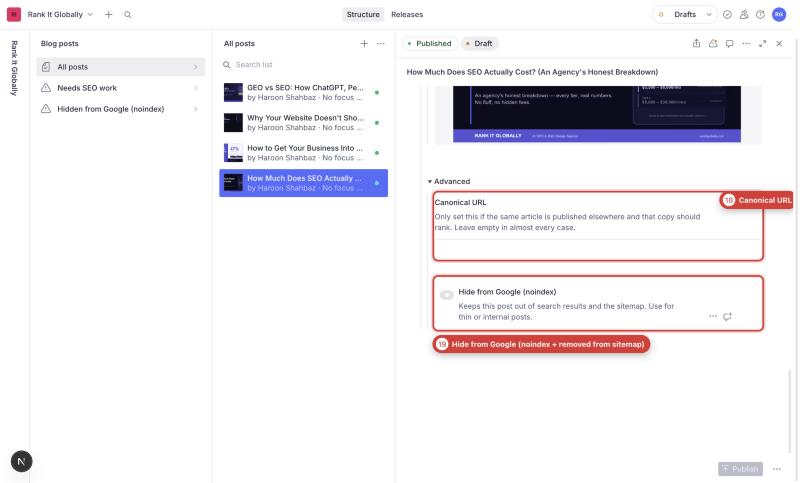

| # | Feature | File | Output |
|---|---|---|---|
| 18 | Canonical URL override | `canonicalUrl` in `seo.ts` | `<link rel="canonical">`. Defaults to the post URL |
| 19 | Hide from Google (noindex) | `noIndex` in `seo.ts` | `robots: noindex, follow`. Also excluded from the sitemap (`src/app/sitemap.ts`) |

## 8. Schema tab: summary and article type

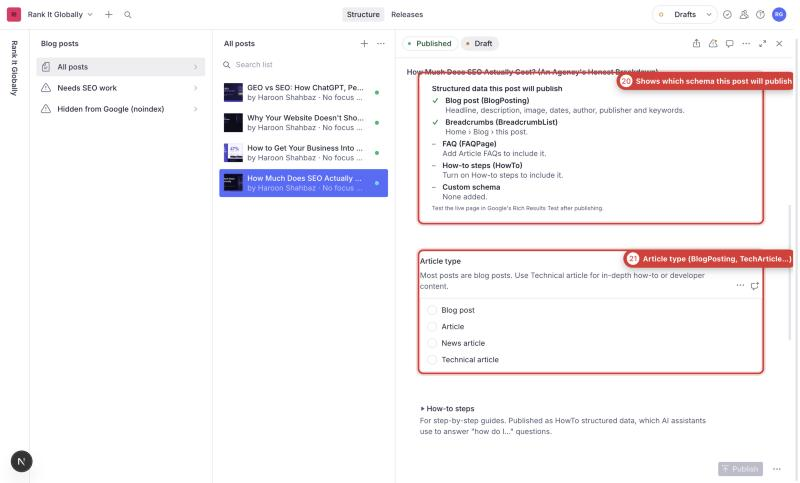

| # | Feature | File |
|---|---|---|
| 20 | "Structured data this post will publish" summary (read-only) | `src/sanity/components/SchemaSummary.tsx` (field `schemaSummary` in `post.ts`) |
| 21 | Article type: BlogPosting / Article / NewsArticle / TechArticle | `articleType` in `post.ts`. Becomes the article node's `@type` in `page.tsx` |

## 9. Schema tab: how-to steps and custom JSON-LD

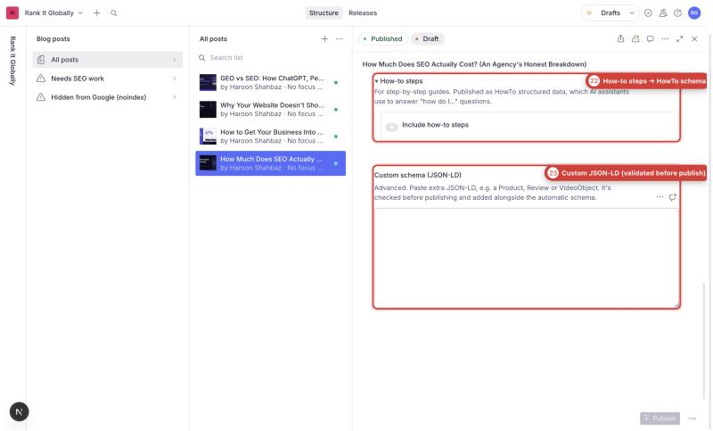

| # | Feature | File | Output |
|---|---|---|---|
| 22 | How-to steps (on/off, title, time, steps) | `howTo` in `post.ts` | `HowTo` node in the JSON-LD `@graph` (`howToSchema` in `page.tsx`) |
| 23 | Custom JSON-LD, validated before publishing | `customSchema` in `post.ts`. Parser/validator: `src/sanity/lib/customSchema.ts`, shared by the Studio and the site | Appended to the JSON-LD `@graph`. Invalid JSON is never published |

## 10. Article FAQs

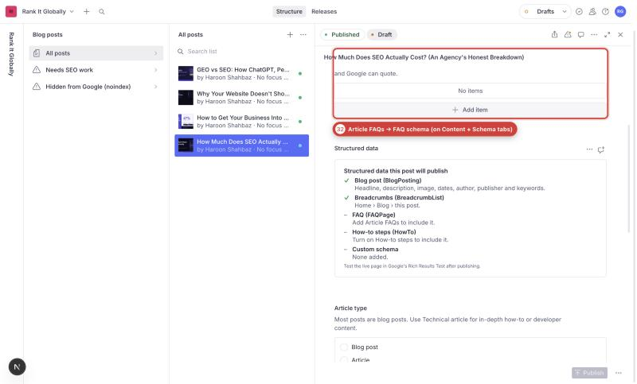

| # | Feature | File | Output |
|---|---|---|---|
| 32 | Article FAQs (on both the Content and Schema tabs) | `faqs` in `post.ts` | Shown under the article (`BlogPostFaqs`) and as a `FAQPage` node in the JSON-LD |

## 11. Settings tab

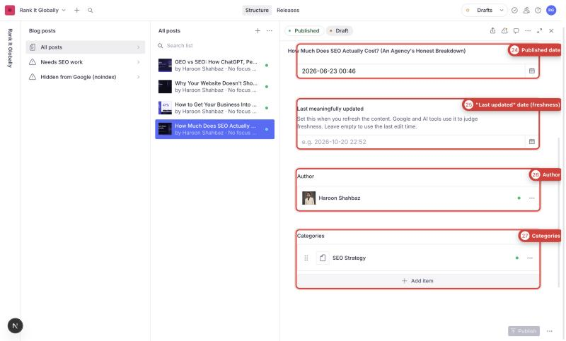

| # | Feature | File | Output |
|---|---|---|---|
| 24 | Published date (defaults to now) | `publishedAt` in `post.ts` | `datePublished` and `article:published_time` |
| 25 | "Last meaningfully updated" date | `updatedAt` in `post.ts` | `dateModified`, `article:modified_time` and the sitemap `lastModified`. Falls back to Sanity's `_updatedAt` |
| 26 | Author | `author` reference | JSON-LD `author` and the author box |
| 27 | Categories | `categories` | JSON-LD `articleSection` and related posts |

## 12. "Needs SEO work" list

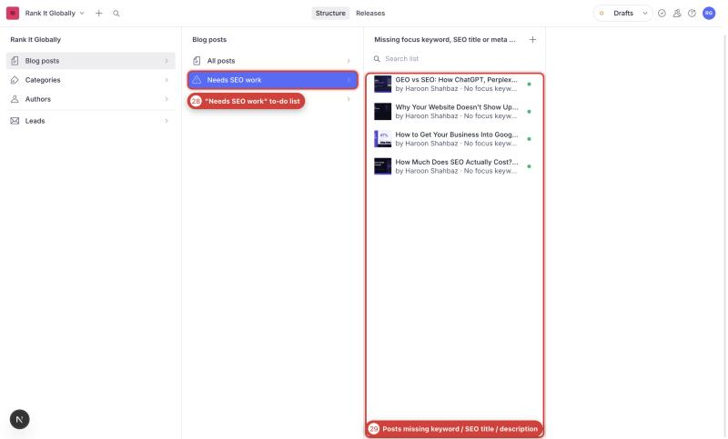

| # | Feature | File |
|---|---|---|
| 28–29 | Lists posts missing a focus keyword, SEO title or meta description | GROQ `filter` in `src/sanity/structure.ts`. Edit it to change what counts as "needs work" |

## 13. Leads

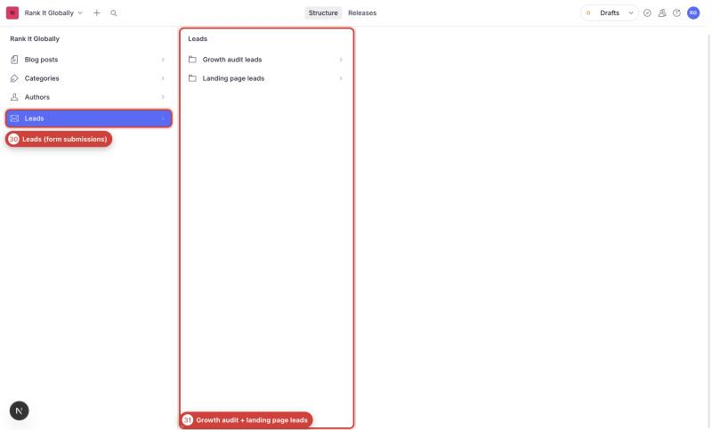

| # | Feature | File |
|---|---|---|
| 30–31 | Growth audit leads and landing page leads from the site forms | `src/sanity/structure.ts`; schemas in `auditLead.ts` and `lpLead.ts` (unchanged) |

---

## Checking changes

- **Schema:** `npx sanity schema validate`. Needs `NEXT_PUBLIC_SANITY_PROJECT_ID=tfcwge09` in `.env.local`.
- **Types and build:** `npx tsc --noEmit` and `npm run build`.
- **Live output:** after publishing a post, test it in Google's Rich Results Test (https://search.google.com/test/rich-results).
- **Gotchas:**
  - Icons: `@sanity/icons` v5 needs per-icon imports, e.g. `import { LinkIcon } from "@sanity/icons/Link"`.
  - Spacing: `@sanity/ui` v4 uses `gap`, not `space`, on `Stack`.
